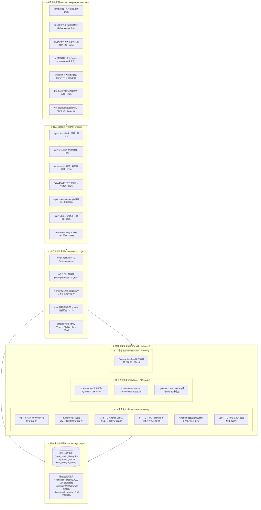
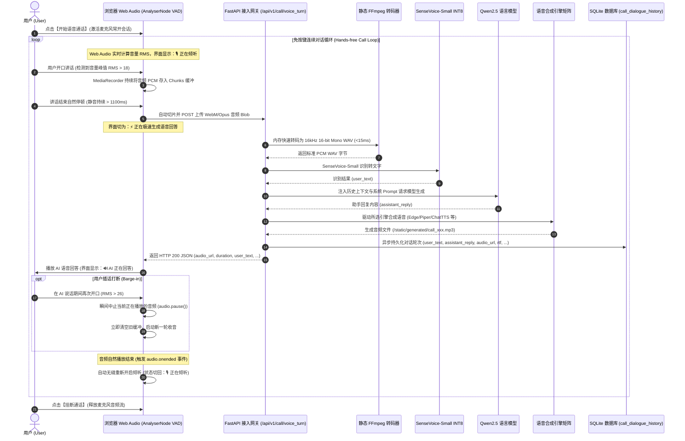
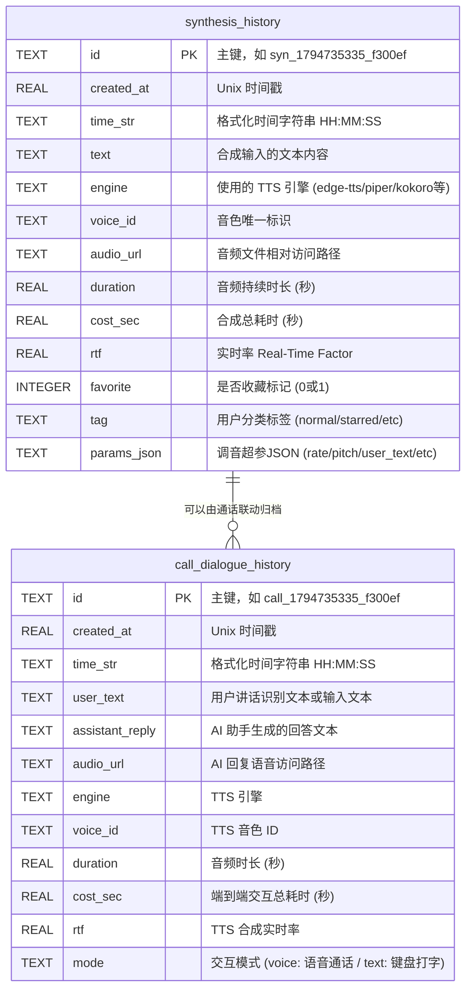

# VoiceStudio 智能语音与大模型管理平台 · 系统架构设计说明书 (Architecture Design Document)

**文档版本：** V2.0 (全景生产就绪版)  
**更新日期：** 2026-11-15  
**运行环境：** Windows 11 / Python 3.12 / FastAPI / PyTorch ROCm / Modern Web SPA (Vue 3 + Tailwind CSS)  
**硬件基准：** AMD Ryzen 7 9800X3D (8核/16线程 CPU) + AMD Radeon RX 9070 XT (16GB 显存 GPU) + 智能音箱/Web麦克风  
**平台服务地址：** Web 控制台 [http://localhost:8000](http://localhost:8000) | API 接口文档 [http://localhost:8000/docs](http://localhost:8000/docs)

---

## 1. 系统定位与核心设计哲学

### 1.1 平台定位
**VoiceStudio** 是一个面向现代化 AI 语音与大模型交互的高性能、完全本地化、纯离线可用的多引擎综合管理平台。平台集成了 **TTS 调音工坊 (Playground)**、**音色矩阵库 (Timbre Matrix)**、**大模型编排中心 (LLM Hub)**、**客观基准评测大厅 (Benchmark Suite)**、**实验历史与标记归档库 (History Lab)** 以及 **全双工免按键实时语音交互电台 (Realtime Voice Station)**。

### 1.2 核心设计原则 (Design Principles)
1. **微内核插件化 (Micro-Kernel Architecture)**：核心调度器（Core Engine）与底层具体驱动（Providers）彻底解耦，TTS、LLM、STT 等外部或本地模型均通过统一抽象基类（Abstract Base Class）挂载，支持热插拔与无缝扩容。
2. **CPU + GPU 异构协同管线 (Heterogeneous Pipelining)**：
   - **CPU (Ryzen 7 9800X3D)**：负责 Web Audio VAD 监听、轻量级 ONNX 语音推理（Piper/Kokoro/MeloTTS 纯 CPU 零显存占用）及 SenseVoice-Small INT8 极速语音转写（~30ms）。
   - **GPU (Radeon RX 9070 XT 16GB)**：负责 Qwen2.5-1.5B/7B 大语言模型推理计算、F5-TTS 扩散流匹配计算及 ChatTTS 潜变量采样。
3. **零外部构建依赖的响应式交互 (Zero-Tooling Web SPA)**：前端基于原生 ES 模块加载 Vue 3、Tailwind CSS 与 Lucide 图标体系，无需 node_modules 复杂的编译打包环节，即开即改即生效。
4. **全双工免按键闭环 (Hands-free Full-Duplex Dialogue)**：集成浏览器 Web Audio API AnalyserNode 能量积分与端点检测（VAD），实现人声自适应启停、静音自动切片、智能即时打断（Barge-in）与播报完毕自动复听的零操作对话闭环。
5. **双规持久化存储 (Dual-Tier Persistence)**：调音实验与多轮通话记录独立归档于本地 SQLite 数据库，实现毫秒级结构化检索、标记筛选与音频回放。

---

## 2. 系统整体分层架构 (Layered Architecture)

平台严格划分为 **表现层、接入与传输层、核心领域层、模型适配层、存储持久层** 5 个层级：



---

## 3. 硬件协同与异构流水线设计

系统根据各算法模型的计算密集度与算子特性，进行了精细的 CPU 与 GPU 算力拓扑分配：

```text
┌────────────────────────────────────────────────────────────────────────┐
│                      【用户终端 / 浏览器 Web SPA】                     │
│  • Web Audio API (AudioContext + AnalyserNode) 实时能量积分与 VAD 计算 │
│  • 静音持续 > 1100ms 自动截断并提交 WebM/Opus 音频 Blob                │
└───────────────────────────────────┬────────────────────────────────────┘
                                    │ HTTP Multipart / JSON
                                    ▼
┌────────────────────────────────────────────────────────────────────────┐
│               【AMD Ryzen 7 9800X3D (8核/16线程 CPU)】                  │
│  1. 静态 FFmpeg 内存流快速转码: WebM/Opus -> 16kHz 16-bit Mono WAV (<15ms)
│  2. SenseVoice-Small INT8: 极速语音转文字 (RTF ~0.015, 单句仅需 25~40ms)│
│  3. 轻量离线 TTS 引擎矩阵 (纯 CPU 驱动，0 显存占用):                     │
│     • Piper-TTS (RTF 0.08~0.12)                                        │
│     • Kokoro-82M (RTF 0.15~0.20)                                       │
│     • MeloTTS-44.1kHz (RTF 0.14~0.18)                                  │
└───────────────────────────────────┬────────────────────────────────────┘
                                    │ 文本序列流
                                    ▼
┌────────────────────────────────────────────────────────────────────────┐
│             【AMD Radeon RX 9070 XT (16GB 高速显存 GPU)】               │
│  1. Qwen2.5-1.5B / 7B Instruct: 语言大模型思考 (首字延迟 TTFT < 25ms)  │
│  2. 重负载生成式 TTS 引擎:                                             │
│     • F5-TTS: 零样本流匹配声音克隆扩散生成 (RTF 0.35~0.50)              │
│     • ChatTTS: 768维潜变量自回归与韵律特征注入 (RTF 0.40~0.60)           │
└───────────────────────────────────┬────────────────────────────────────┘
                                    │ 生成音频流
                                    ▼
┌────────────────────────────────────────────────────────────────────────┐
│                   【声学后处理与客户端响应流水线】                     │
│  1. AudioCadenceService: 250Hz 胸腔温暖 EQ + 3500Hz 辅音辨析 + 半余弦淡出│
│  2. SQLite 异步归档入库 (call_dialogue_history / synthesis_history)    │
│  3. 浏览器端 Audio 元素自动播放，支持用户强势说话即刻打断 (Barge-in)   │
└────────────────────────────────────────────────────────────────────────┘
```

---

## 4. 核心功能子系统设计

### 4.1 语音合成引擎与音色矩阵 (TTS Subsystem)
系统已集成 **6 大技术流派**的语音合成引擎，共包含 **31 款高拟真音色**：

| 引擎名称 | 架构类型 | 硬件需求 | 典型 RTF | 支持语言 / 音色数 | 核心特色与专属参数 |
| :--- | :--- | :--- | :--- | :--- | :--- |
| **Piper-TTS** | VITS ONNX | 纯 CPU (0 显存) | **0.08 ~ 0.12** | 中文女声 (Huayan) / 英文男声 (Lessac) | 超轻量极速离线推理，支持 `length_scale` (0.5~2.0x) 语速平滑缩放 |
| **Kokoro-82M** | 蒸馏 StyleTTS2 | 纯 CPU (0 显存) | **0.15 ~ 0.20** | 中文女声、男声 / 英文 (共4款) | 82M 参数量轻量之王，单句生成 <0.3s，发音自然生动 |
| **MeloTTS** | VITS 44.1kHz | 纯 CPU (0 显存) | **0.14 ~ 0.18** | 中英双语混读 (Bilingual) | 44.1kHz 超高保真广播级音质，评测准确率 100.0% (CER=0.0%) |
| **F5-TTS** | 非自回归流匹配 (Flow Matching) | GPU 加速 (RX 9070 XT) | **0.35 ~ 0.50** | 3款预设声线 + 用户零样本克隆 | 彻底杜绝自回归模型的重复与吞字；支持 3~5 秒音频零样本声音克隆，支持 ODE 步数 (NFE: 16~64) 与 CFG 引导系数 (1.0~3.5) |
| **ChatTTS** | 自回归潜变量 | CPU / GPU 混合 | **0.40 ~ 0.60** | 6款精选种子 (`spk_2222`, `spk_7869` 等) | 拟人口语日常闲聊，支持笑声 `[laugh]`、微停顿 `[break]` 及语气词注入 |
| **Edge-TTS** | 云端神经网络 | 纯网络 (0 显存) | **0.25 ~ 0.35** | 14款方言与多国语种 (东北/陕西/台湾/粤语等) | 工业级云端发音基准，极高文本对齐准确率，支持 Rate (-50%~+100%) 与 Pitch (-20Hz~+20Hz) |

---

### 4.2 免按键全双工连续语音交互电台 (Hands-Free Full-Duplex Subsystem)
针对桌面端人机语音交流痛点，系统实现了**常开麦克风、免按键、自适应断句与自动复听**的连续对话闭环。



---

### 4.3 数据持久化与归档模型 (Storage & Schema)
数据统一存储在本地 SQLite 数据库文件 [voice_studio_history.db](file:///g:/code/backend/clouldflare/voice_agent/voice_studio_history.db) 中，设计了两张业务解耦的数据表：



---

### 4.4 客观自动化评测流水线 (Benchmark & Evaluation Subsystem)
为了科学量化各 TTS 引擎在不同场景下的合成质量，系统基于 **SenseVoice-Small INT8** 实现了自动化评测体系：
* **8 大标准分类测试集**：
  1. `daily`：日常口语对话与陪伴；
  2. `emotion`：欢快、悲伤、愤怒、撒娇等情绪表现；
  3. `numbers`：身份证、电话号码、金额、小数等数字正规化（TN）；
  4. `multilingual`：中英专业技术术语与混合读音；
  5. `punctuation`：逗号换气、分号大停顿、感叹句重音；
  6. `articulation`：绕口令与复杂声母韵母发音辨析；
  7. `longtext`：长篇有声书与技术长文吐字稳定性；
  8. `all`：全量自动化评测回归。
* **客观度量指标体系**：
  * **发音准确率 (Accuracy %)**：基于 Levenshtein 编辑距离算法比对期望文本与 ASR 识别文本，$\text{Accuracy} = \max(0, 1 - \text{CER}) \times 100\%$；
  * **字错误率 (Character Error Rate, CER)**：$\text{CER} = \frac{S + D + I}{N}$，精确定位错字、漏字与多字；
  * **实时率 (Real-Time Factor, RTF)**：$\text{RTF} = \frac{\text{合成耗时 (s)}}{\text{音频长度 (s)}}$，衡量算法推理速度，$\text{RTF} < 1.0$ 即可满足实时流式通话要求。

---

## 5. 项目工程目录映射与核心源码结构

```text
G:\code\backend\clouldflare\voice_agent/
├── main_server.py             # ★【Web 平台统一启动入口】：FastAPI 挂载所有路由并提供 HTTP 服务
├── voice_studio_history.db    # ★【本地持久化 SQLite 数据库】：存储调音记录与连续通话对话历史
├── ARCHITECTURE.md            # ★【本系统架构设计说明书 (V2.0)】
├── README.md                  # 用户使用与快速入门部署指南
├── TTS_TEST_SPECIFICATION.md  # 语音基准测试用例规范文档
│
├── app/                       # ★【平台核心工程包】
│   ├── api/                   # API 控制器与路由层
│   │   ├── routes_tts.py      # TTS 合成、试听、参数校验接口
│   │   ├── routes_voices.py   # 音色矩阵、分类筛选与元数据接口
│   │   ├── routes_llm.py      # 大模型驱动管理、角色预设与在线对话
│   │   ├── routes_call.py     # ★ 全双工实时语音/文字通话引擎与持久化接口
│   │   ├── routes_benchmark.py# 自动化评测大厅执行与报表接口
│   │   ├── routes_history.py  # 历史记录增删改查、收藏标记管理
│   │   └── routes_telemetry.py# CPU、GPU显存、系统内存实时遥测接口
│   │
│   ├── core/                  # 领域服务核心逻辑
│   │   ├── base.py            # BaseTTSProvider, BaseLLMProvider, BaseSTTProvider 抽象基类
│   │   ├── config.py          # 系统全局配置与路径环境变量定义
│   │   ├── voice_manager.py   # 6 大 TTS 引擎音色库注册中心
│   │   ├── history_manager.py # ★ SQLite 数据库双表持久化操作管理
│   │   └── sound_processor.py # 250Hz 胸腔共鸣 EQ、3500Hz 辅音增强与半余弦淡出
│   │
│   ├── providers/             # 驱动适配层 (适配各类不同模型)
│   │   ├── tts/               # 6 大语音合成驱动插件
│   │   │   ├── edge_provider.py      # Edge-TTS (微软云端无损音色)
│   │   │   ├── chattts_provider.py   # ChatTTS (自回归潜变量拟人口语)
│   │   │   ├── kokoro_provider.py    # Kokoro-82M (轻量 StyleTTS2 纯 CPU)
│   │   │   ├── melo_provider.py      # MeloTTS (Sherpa-ONNX 44.1kHz 极速)
│   │   │   ├── piper_provider.py     # Piper-TTS (轻量 VITS ONNX 纯 CPU)
│   │   │   └── f5_provider.py        # F5-TTS (零样本流匹配扩散克隆 GPU)
│   │   │
│   │   ├── llm/               # 3 大语言模型渠道驱动
│   │   │   ├── local_llm_provider.py # 本地 Transformers (Qwen2.5 GPU 推理)
│   │   │   └── cloudflare_llm.py     # Cloudflare Workers AI 云端驱动
│   │   │
│   │   └── stt/               # 语音识别驱动
│   │       └── sensevoice_stt.py     # SenseVoice-Small INT8 本地模型
│   │
│   └── static/                # 前端单页应用与静态资产
│       ├── index.html         # ★ 响应式现代 Web 控制台 (Vue 3 + Tailwind CSS)
│       └── generated/         # 运行时合成音频与通话对话录音存储目录
│
├── speakers/                  # 音色样本与参考音频库 (含 edge/ 与克隆基准样本)
├── models/                    # 本地离线模型权重目录 (SenseVoice, Silero-VAD, Piper等)
├── benchmark_results/         # 自动化评测报告生成的 Markdown / CSV 归档
├── run_tts_benchmark.py       # 终端版 8 大分类评测跑分套件
└── realtime_call.py           # 终端版原生全双工通话客户端 (保持向后兼容)
```

---

## 6. RESTful API 接口全景速查

| HTTP 方法 | 请求路径 | 请求格式 | 核心功能与响应说明 |
| :--- | :--- | :--- | :--- |
| **POST** | `/api/v1/tts/synthesize` | `JSON` | 核心文本合成，返回音频 URL、耗时、音频时长及 RTF |
| **GET** | `/api/v1/voices` | Query: `engine`, `gender` | 获取当前 6 大引擎支持的 31 款音色列表与元信息 |
| **POST** | `/api/v1/call/voice_turn` | `Multipart/Form-Data` | **全双工语音通话**：接收麦克风 WebM/WAV 音频，执行 ASR 识别 + LLM 思考 + TTS 生成并持久化归档 |
| **POST** | `/api/v1/call/text_turn` | `JSON` | **文字通话**：输入纯文本，直接与所选角色和大模型对话并生成语音回复 |
| **GET** | `/api/v1/call/history` | Query: `limit` (默认100) | 获取结构化多轮连续对话历史列表 (含用户提问与 AI 回复) |
| **DELETE** | `/api/v1/call/history` | - | 一键清空所有已归档的通话对话历史 |
| **GET** | `/api/v1/tts/history` | Query: `limit`, `favorite_only` | 获取调音工坊实验历史列表，支持收藏标记过滤 |
| **POST** | `/api/v1/tts/history/{id}/star` | - | 切换指定合成记录的收藏状态 (Star/Unstar) |
| **DELETE** | `/api/v1/tts/history/{id}` | - | 删除指定的合成历史记录与对应磁盘音频文件 |
| **POST** | `/api/v1/benchmark/run` | `JSON` | 触发指定引擎与分类的基准测试流水线 |
| **GET** | `/api/v1/benchmark/reports` | - | 获取历史自动化基准测试报告列表与评分总结 |
| **GET** | `/api/v1/telemetry` | - | 实时获取当前 CPU 负载、GPU 显存使用量、内存使用率等系统健康状态 |

---

## 7. 未来演进与市面开源模型接入评估

| 待接入模型 | 开源机构 / 规模 | 架构特征 | 适用场景与接入规划 |
| :--- | :--- | :--- | :--- |
| **CosyVoice 2 / 3** | 阿里 FunAudioLLM / 0.3B~0.5B | 多语言预训练 + Flow 匹配 | 极高保真度声音克隆，Windows 预编译 C++ 依赖就绪后即可接入 |
| **Fish Speech S1-mini** | Fish Audio / 0.5B | 双自回归 Transformer + VQ-GAN 离散 Tokenizer | 二次元情感角色扮演与长音频自然叙事演播 |
| **VibeVoice** | 微软研究院 / 1.5B | 7.5Hz 超低帧率连续音频 Tokenizer | 专注超长序列处理，可实现多达 4 人的多人播客与会议角色对话自动生成 |
| **Qwen3-TTS** | 阿里千问团队 | 开放式 Voice Design 提示词生成音色 | 结合千问多模态基座，支持直接通过文本描述提示词实时设计声线 |
